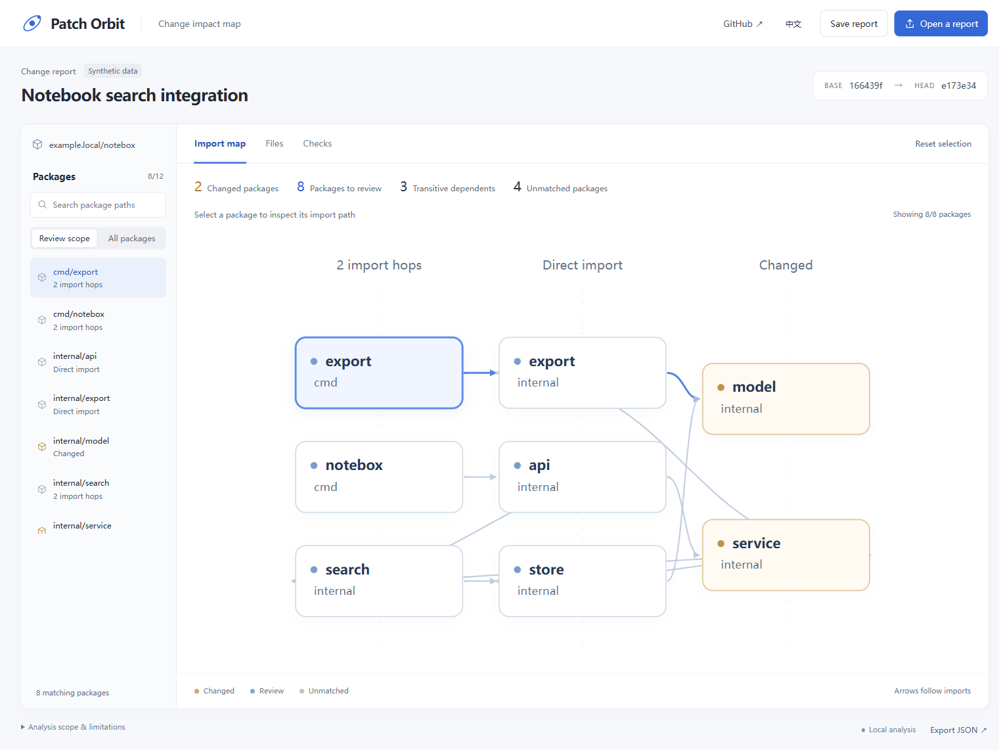
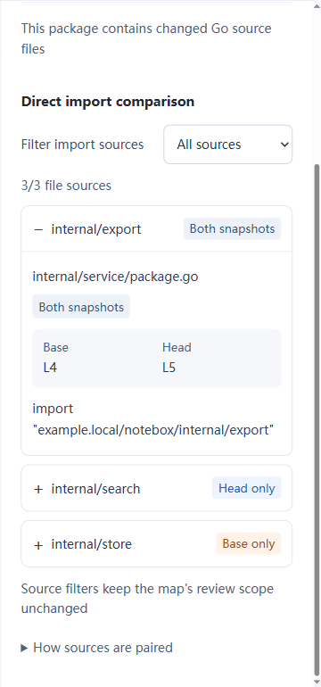

# Patch Orbit

### See where a Go change travels

[Explore the map →](https://chenpingan-dev.github.io/patch-orbit/) · [Download](https://github.com/chenpingan-dev/patch-orbit/releases) · [English](README.md) / [简体中文](README.zh-CN.md)

[](https://github.com/chenpingan-dev/patch-orbit/actions/workflows/ci.yml) [](LICENSE)

Patch Orbit is a **Go (Golang) change impact analysis tool for code review**. Turn a Git diff between two committed snapshots into an interactive package dependency graph, follow reverse dependencies, and inspect the import file and line behind each link. Open the analysis as an offline HTML report and export a Markdown verification checklist.

中文：Go 变更影响分析与依赖关系可视化工具，从 Git 提交差异定位需要复查的包，辅助代码评审



- **Visualize package dependencies** — explore changed packages and their direct or indirect dependents
- **Compare imports** — see base-only, head-only and shared sources, including exact positions when an import moves lines
- **Take the next step** — review changed files and save a test checklist from dedicated views

One Go executable, two committed snapshots, one portable HTML report. No service to run, no model API key to configure.

<a id="try-it"></a>

## Inspect a change

Go 1.23+ and Git. No model API, database, indexing service or external Go module dependencies.

```sh
go install github.com/chenpingan-dev/patch-orbit/cmd/orbit@v0.1.2
orbit -repo /path/to/your/go-repo -base HEAD~1 -head HEAD -html impact.html -json impact.json
```

Or download a binary from [Releases](https://github.com/chenpingan-dev/patch-orbit/releases). Open `impact.html` in your browser. Specify a root module repository; both commits need a root `go.mod`. Existing outputs need `-force`.

## Compare an import before and after a change

Select a package, then open a target under **Direct import comparison**. A changed package exposes its own imports too. Choose **Base only**, **Head only** or **Both snapshots** to filter file sources; the map and test checklist keep their full review scope. Expand **Inspect the full impact path** to follow a dependent package back to a changed package.

For example, the synthetic notebook report replaces `service → store` with `service → search`. The inspector keeps the old `store` source, shows the new `search` source, and pairs the retained `export` import at base L4 / head L5. Moving a line is not treated as removing and adding an import. Matching uses file path, import path and test-file status; a file rename remains separate before/after evidence.



These labels describe **parsed evidence**, not a guarantee that a dependency was added or removed: skipped or invalid source files can affect the result. Review the scan notes. Existing `patch-orbit/v1` JSON reports remain importable; regenerate older reports to correct locations affected by Go `//line` directives.

## Change impact analysis and dependency visualization

- A changed / dependent / unmatched package map, with search and clickable nodes
- Shortest reverse-import chains and exact import evidence from both commits
- Deleted packages and removed imports retained from the base snapshot
- A full test command plus a focused package checklist; generating reports runs **no tests**
- CN/EN switch, report JSON import/export, Markdown checklist and portable offline HTML
- A built-in report generated from two local synthetic commits using the same analyzer

## What the map means

This is a **conservative review scope**, not a runtime bug prediction or proof that unmatched packages are safe. Base and head imports are unioned, including `_test.go` and all build-tag variants. Go module manifest changes put all discovered packages in scope.

v0.1 operates on package imports within one root module. It excludes vendor, hidden/underscore directories, testdata and nested modules. Runtime calls, reflection, embedded resources, external modules and uncommitted files are not modeled. Renames appear as delete/add. Symlinks are not dereferenced. Invalid import syntax and unresolved local imports become scan notes. No worktree files are executed, no fetch or Go builds are run by the analyzer.

Limits per snapshot: 3,000 selected files and 32 MiB total; blobs above 1 MiB are skipped with notes. The diagram shows up to 80 packages; the searchable list and JSON retain the full result. The file panel shows the first 30 changes with its displayed/total count. Reports contain module and file paths: inspect before sharing.

## Develop

```sh
git clone https://github.com/chenpingan-dev/patch-orbit.git
cd patch-orbit
go test ./...
go vet ./...
go run ./cmd/demo
```

The builder creates and removes a fresh synthetic repository under ignored `build/`, then emits `build/index.html` and `build/report.json`. Fixture history stays local. GitHub Pages serves the generated offline report.

[Design](docs/design.md) · [Architecture](docs/architecture.md) · [Roadmap](docs/roadmap.md) · [Contributing](CONTRIBUTING.md)

Related work: [GitNexus](https://github.com/abhigyanpatwari/GitNexus) provides broader code intelligence and impact tooling. Patch Orbit focuses on committed Go package imports, a single executable and a report with explicit import evidence. Independent, AI-assisted implementation; no upstream code is included.
