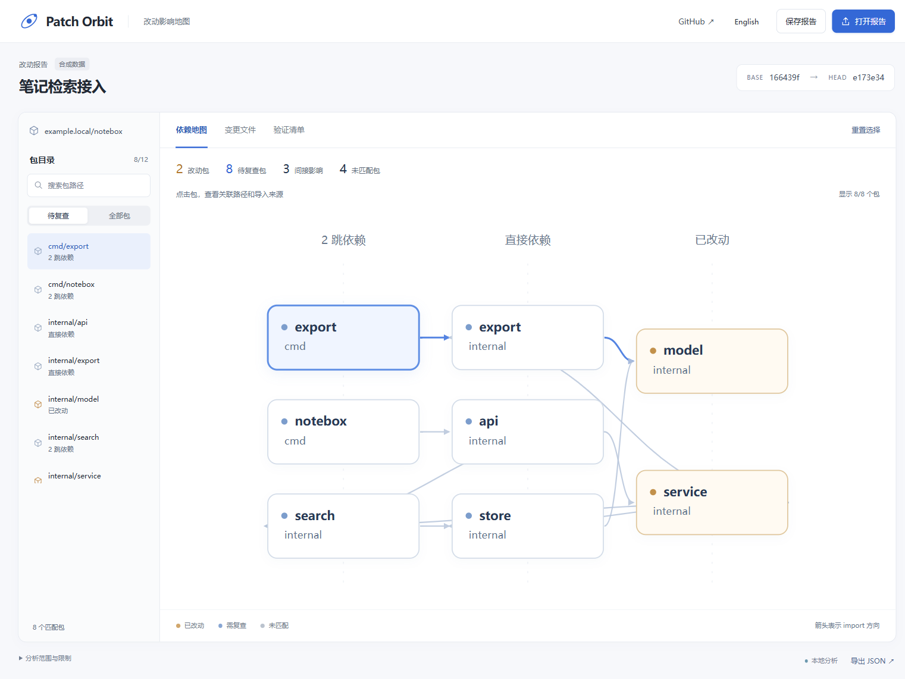
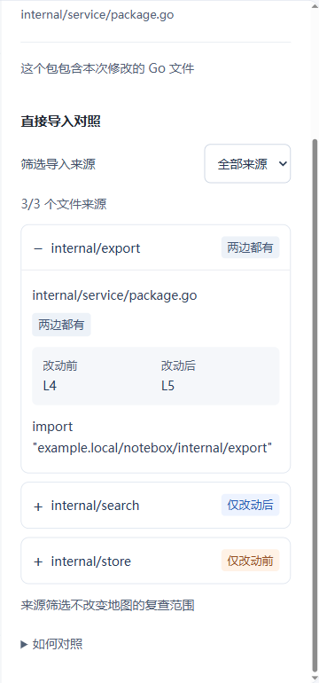

# Patch Orbit

### 看清一处 Go 改动，连着哪些包

[打开依赖地图 →](https://chenpingan-dev.github.io/patch-orbit/) · [下载工具](https://github.com/chenpingan-dev/patch-orbit/releases) · [English](README.md) / [简体中文](README.zh-CN.md)

Patch Orbit 是一个面向代码评审的 **Go（Golang）变更影响分析与依赖关系可视化工具**，从两个已提交版本的 Git diff 生成包依赖图，沿反向依赖找到需要复查的包，并用 import 文件与行号说明每条关联



- **看复查范围**：区分已改动的包、直接依赖者和间接依赖者
- **对照导入来源**：区分仅改动前、仅改动后和两边都有，查看行号移动前后的源码位置
- **继续验证**：独立查看变更文件，复制测试命令或下载复查清单

一个 Go 程序、两个已提交的版本、一份可离线打开的 HTML 报告，无需部署服务或配置模型 API Key

## 使用

需要 Git 和 Go 1.23+，也可以直接从 [Releases](https://github.com/chenpingan-dev/patch-orbit/releases) 下载编译好的程序

```sh
go install github.com/chenpingan-dev/patch-orbit/cmd/orbit@v0.1.2
orbit -repo 你的Go仓库路径 -base HEAD~1 -head HEAD -html impact.html -json impact.json
```

浏览器打开 `impact.html`，支持中英文切换、包搜索、来源查看和报告导入导出。已有报告需要 `-force` 才能覆盖，两个版本都要有根目录 `go.mod`

## 对照改动前后的 import

选中一个包，在「直接导入对照」中展开目标包，改动包也能查看自己的导入。选择「仅改动前」「仅改动后」或「两边都有」筛选文件来源，地图与验证清单仍保留完整复查范围。需要追溯依赖者时，展开「查看完整关联路径」

内置的合成笔记仓库把 `service → store` 换成 `service → search`：来源面板会保留旧的 `store` 导入、显示新的 `search` 导入，并把保留的 `export` 导入配对为改动前 L4 / 改动后 L5。只移动行号不会被误标为删除和新增；配对依据是文件路径、import 路径和测试文件标记，文件重命名仍作为前后独立来源



状态只说明在哪个快照中**解析到了来源**，不保证依赖一定被新增或移除；被跳过或语法无效的文件也会影响结果，请结合扫描提示检查。旧的 `patch-orbit/v1` JSON 报告仍可导入；旧报告若受到 Go `//line` 指令影响，需要重新生成才能修正源码位置

## 变更影响分析与依赖图的范围

依赖图合并改动前后的 import，所以删除的包和移除的依赖不会直接消失。包含测试文件和全部构建条件；依赖清单变化时把整个模块纳入复查

当前按单模块的包导入关系分析，不覆盖运行时调用、反射、嵌入资源、外部模块和未提交改动。未匹配包不代表绝对安全，生成报告不会执行源码、测试、构建或远程拉取

跳过 vendor、隐藏目录、下划线目录、testdata、嵌套模块和符号链接。无效 import、缺失本地包和过大文件会留下扫描提示。每个快照最多选择 3,000 个文件 / 32 MiB，超过 1 MiB 的单个文件会跳过

地图最多展示 80 个节点，完整结果保留在列表和 JSON；文件页显示前 30 项并标注数量。报告含模块与文件路径，分享前请检查内容。在线地图由两个本地合成 Git 提交分析生成

## 本地开发

```sh
go test ./...
go vet ./...
go run ./cmd/demo
```

[界面设计](docs/design.md) · [架构](docs/architecture.md) · [路线图](docs/roadmap.md) · [参与贡献](CONTRIBUTING.md)

MIT · 独立、AI 辅助开发
